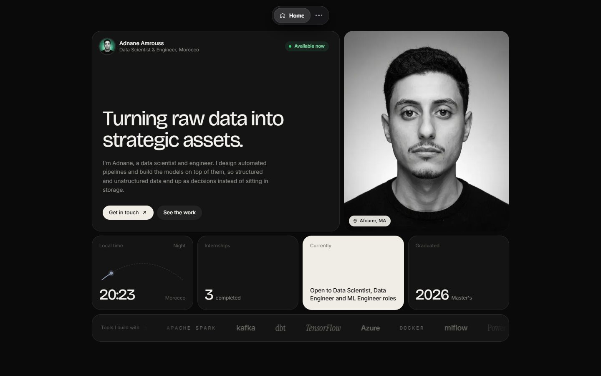

# Adnane Amrouss — Portfolio

Personal portfolio of **Adnane Amrouss**, Data Scientist & Engineer based in Morocco.
It presents my projects (data platforms, machine learning, a full-stack mobile app), my experience, education and skills, in English and French.

**Live site:** [amrouss.com](https://www.amrouss.com)



## Features

- **Bento-style dark design** with cards, a live Morocco clock and a scrolling tools strip
- **Top tab bar** that follows the section in view; hover the `•••` button (or tap it on mobile) to open the full menu
- **Selected work:** a featured project followed by a two-column grid, each with an animated product mockup and its own detail page
- **3D flip text** on the hero, About and Contact headlines, revealed letter by letter on load or on scroll
- **Experience and Education carousels** with company and school logos
- **Skills accordion:** open a field to see what I do in it, my focus areas, the tools I use and a related project
- **Bilingual (EN / FR):** the language is detected from the browser and can be switched from the menu
- **Smooth scrolling** with Lenis, page transitions and reduced-motion support
- **Contact form** that opens a pre-filled email, or posts to a form service when configured

## Tech stack

| | |
|---|---|
| Framework | [Next.js 15](https://nextjs.org) (App Router), [React 19](https://react.dev) |
| Language | TypeScript |
| Styling | CSS Modules and CSS variables (no UI library) |
| Animation | [Framer Motion](https://motion.dev) |
| Smooth scroll | [Lenis](https://lenis.darkroom.engineering) |
| Fonts | Bricolage Grotesque (headings), Inter (text), Geist Mono, Instrument Serif via `next/font` |

## Getting started

Requirements: Node.js 18.18 or newer (developed with Node 22).

```bash
git clone https://github.com/adnane-amrs/<repo-name>.git
cd <repo-name>
npm install
npm run dev        # http://localhost:3000
```

Production build:

```bash
npm run build
npm start
```

## Editing the content

All text lives in `src/content/`; components never hold copy, so most changes need no code.

| What | Where |
|---|---|
| Name, email, phone, links, photos, CV paths | `src/content/site.ts` |
| Page text (hero, about, experience, skills, contact…) | `src/content/en.ts` and `src/content/fr.ts` |
| Projects (the first one is the featured card) | `src/content/projects.en.ts` and `src/content/projects.fr.ts` |
| Company and school logos | `logos` in `src/content/site.ts` |
| Colours, fonts, spacing | CSS variables at the top of `src/app/globals.css` |

Both languages share the same types (`src/content/types.ts`), so TypeScript flags any text missing in one of them.

### CV files

The "Download CV" buttons point to:

```
public/cv/Amrouss_Adnane_en.pdf
public/cv/Amrouss_Adnane_fr.pdf
```

### Logos

Put the images in `public/logos/` and set their path in `src/content/site.ts`:

```ts
logos: {
  d3soft: { src: "/logos/d3-soft.png", initials: "D3" },
  // ...
}
```

While `src` is empty, the circle shows the initials instead.

### Contact form (optional)

By default the form opens the visitor's email app with the message filled in.
To receive messages directly, create a form on a service that accepts a JSON `POST` (for example [Formspree](https://formspree.io)) and add its URL to `.env.local`:

```
NEXT_PUBLIC_CONTACT_ENDPOINT=https://formspree.io/f/your-form-id
```

`.env*` files are ignored by Git.

## Project structure

```
src/
├── app/                    # Routes, root layout (fonts, SEO), global styles
│   ├── page.tsx            # Home page
│   ├── contact/            # /contact
│   └── projects/[slug]/    # One page per project
├── content/                # All text and data (EN / FR)
├── components/
│   ├── layout/             # Top tab bar (Dock), Footer
│   ├── sections/           # Hero, Projects, About, Experience, Education, Skills, Contact
│   ├── project/            # Project detail page
│   ├── contact/            # Contact form
│   ├── widgets/            # Animated project mockups
│   └── ui/                 # FlipText, Reveal, TransitionLink, Icons
├── hooks/                  # Lenis-aware section scrolling
└── providers/              # Language, smooth scroll, page transitions
```

## Deployment

The site is a standard Next.js app and deploys as is on [Vercel](https://vercel.com): import the repository, keep the default settings, and add `NEXT_PUBLIC_CONTACT_ENDPOINT` in the project's environment variables if you use the contact form service.

## Credits

The design draws inspiration from these Framer templates and examples:
[Sunroom](https://sunroomtemplate.framer.website/) (layout and typography),
[Reveal text on scroll](https://reveal-text-on-scroll.framer.website/) (3D flip),
[a testimonial carousel](https://fresh-someone-707835.framer.app/) (experience and education),
[Hover team](https://hoverteampro.framer.website/) and [Tech stack section](https://techstacksection.framer.website/) (skills).
All code in this repository was written for this site.

## License

© Adnane Amrouss. The personal content (text, photos, CV) is not licensed for reuse.
